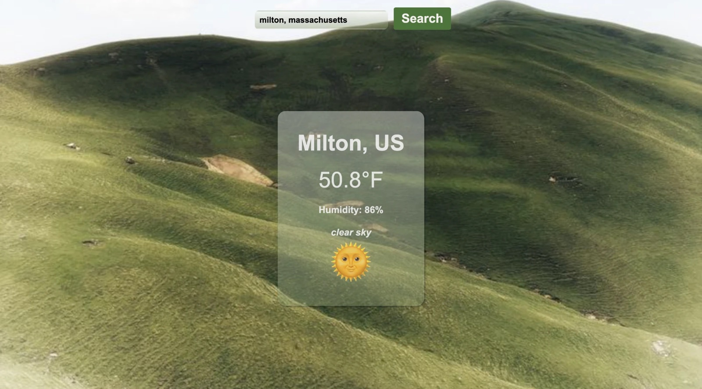

# Weather Search 🌦️

A page where you enter a city and see its current temperature in Fahrenheit, plus the humidity and a weather emoji.

## Description

This is a project I built to practice getting data from a weather API and showing it on the page. You type in a city (and a country or state if you want), press search, and a card appears with the city name, the temperature, the humidity, a short description of the weather, and an emoji to match. The weather service sends the temperature in Kelvin, so the page converts it to Fahrenheit. It uses plain HTML, CSS, and JavaScript with `async`/`await`, so there is no server to run.

## Screenshot

## Features

- Search any city, like "milton, massachusetts"
- Shows the temperature in Fahrenheit (converted from Kelvin)
- Shows the humidity percentage
- Shows a short description, like "clear sky"
- Shows an emoji that matches the weather, from thunderstorm to snow to clear sky
- Shows a message if the search box is empty or the city can't be found
- Frosted glass card over a hills background

## Tech Used

- HTML
- CSS
- JavaScript
- `async`/`await`
- [OpenWeatherMap API](https://openweathermap.org/api) (current weather)

## How to Use

This app doesn't need a server. It needs a free OpenWeatherMap key.

1. Download or clone the project.
2. Make a free account at [openweathermap.org](https://openweathermap.org/api) and copy your API key. A new key can take a little while before it starts working.
3. Open `js/main.js` and put your key in the `key` variable at the top.
4. Open `index.html` in your browser (or use the Live Server extension in VS Code).
5. Type a city and click **Search**.

## How It Works

1. When you submit the form, `main.js` reads the city. If it's empty, it shows "Please enter a city".
2. It uses `fetch` to ask OpenWeatherMap for the weather in that city.
3. If the answer isn't OK (like a city that doesn't exist), it throws an error and the page shows a message.
4. Otherwise it pulls out the city, country, temperature, humidity, description, and a weather code.
5. It converts the temperature from Kelvin to Fahrenheit, picks an emoji from the weather code, and builds the card on the page.

## What I Learned

- How to use `async`/`await` with `fetch` and `try`/`catch` to handle errors
- How to pull values out of an object with destructuring
- How to convert Kelvin to Fahrenheit
- How to use a `switch` to turn a weather code into an emoji
- How to build elements with JavaScript and add them to the page
- How to make a frosted glass card with CSS

## Author

Maya Rose 🌹
